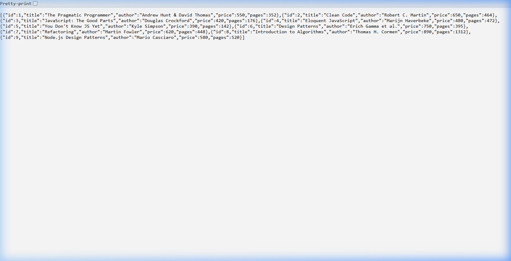
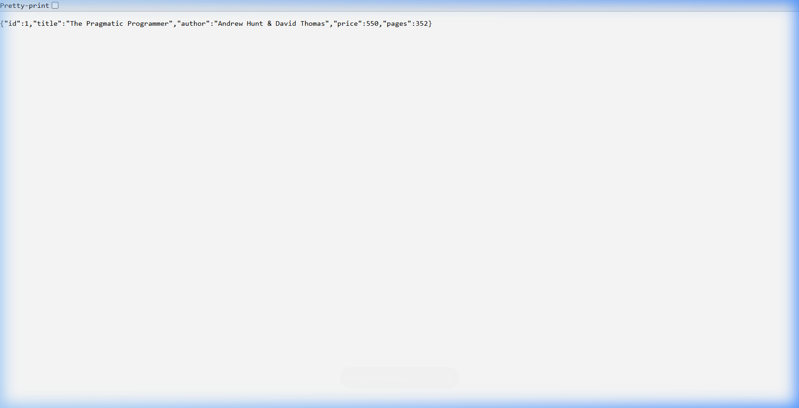
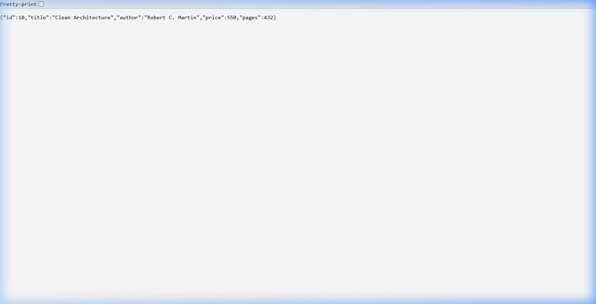
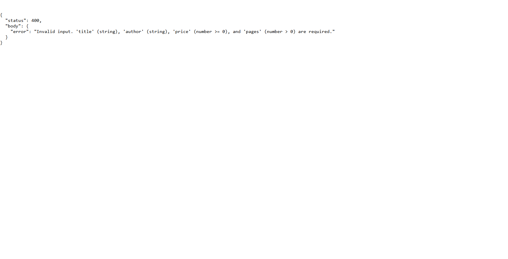

# Lab 2: SQLite Database and CRUD Routes

## Student Details

- **Name:** Manvith Kumar
- **Registration Number:** 252U1R8014
- **Section:** S-14

## Live Link

🔗 **[https://lab-02-sqlite-server-bh0k.onrender.com](https://lab-02-sqlite-server-bh0k.onrender.com)**

## Project Description

This project implements a RESTful API for a book management system using Node.js, Express, and SQLite. It provides complete CRUD (Create, Read, Update, Delete) operations with parameterized queries to prevent SQL injection, and starts the Express server only after establishing a verified database connection.

## Requirements

- **Runtime:** Node.js (v18+)
- **Packages:**
  - `express`: Minimalist web framework for Node.js
  - `sqlite`: Promise-based wrapper for SQLite
  - `sqlite3`: Native SQLite3 driver
  - `nodemon` (devDependencies): Development server with hot-reload

## How to Install and Run

1. Navigate to the `lab-02` directory:
   ```bash
   cd lab-02
   ```

2. Install dependencies:
   ```bash
   npm install
   ```

3. Initialise the database (first time only):
   ```bash
   node init-db.js
   ```

4. Run in development mode (with auto-restart via Nodemon):
   ```bash
   npm run dev
   ```

5. Run in production mode:
   ```bash
   npm start
   ```

The server will be available at `http://localhost:3000`.

*Environment Variables:* None required. The server defaults to port `3000` (or `process.env.PORT` if set).

## Database

- **File Location:** `database/books.db`
- **Init Script:** `database/init.sql`

### Table Schema (`book`)

| Column | Type | Constraints |
|---|---|---|
| `id` | INTEGER | PRIMARY KEY |
| `title` | TEXT | |
| `author` | TEXT | |
| `price` | INTEGER | |
| `pages` | INTEGER | |

### Inspecting via SQLite CLI

```bash
sqlite3 database/books.db
```

Inside the SQLite prompt:
```sql
.tables
.schema book
SELECT * FROM book;
.exit
```

Initial seed data includes 9 sample books.

## Endpoints

| Method | Path | Description | Expected Status Codes |
|---|---|---|---|
| `GET` | `/books/` | Retrieve all books from the database | `200 OK` |
| `GET` | `/books/:bookId/` | Retrieve a single book by ID | `200 OK`, `404 Not Found`, `400 Bad Request` |
| `POST` | `/books/` | Insert a new book record | `201 Created`, `400 Bad Request` |
| `PUT` | `/books/:bookId/` | Update all editable fields of an existing book | `200 OK`, `404 Not Found`, `400 Bad Request` |
| `DELETE` | `/books/:bookId/` | Delete an existing book by ID | `200 OK`, `404 Not Found`, `400 Bad Request` |
| `ANY` | Unknown path | Catch-all handler for undefined routes | `404 Not Found` |

## Screenshots

### 1. GET All Books (`GET /books/`)


### 2. GET Single Book (`GET /books/1/`)


### 3. POST New Book (`POST /books/`)


### 4. GET Newly Created Book (`GET /books/10/`)


### 5. PUT Update Book (`PUT /books/10/`)


### 6. DELETE Book (`DELETE /books/10/`)


### 7. Non-Existent Book 404 (`GET /books/99999/`)


### 8. Invalid Input 400 (`POST /books/` with bad data)


## Notes

- **Database Connection Synchronisation:** `initializeDBAndServer()` guarantees the Express server does not accept HTTP requests before the SQLite connection is established.
- **SQL Injection Prevention:** All queries that handle user input (`:bookId` and request body fields) use parameterised queries (`?` placeholders).
- **Input Validation:** Each write endpoint (POST/PUT) validates field types and ranges before touching the database, returning `400` for invalid payloads.
- **Node.js v24 Compatibility:** Node.js 24's built-in `node:sqlite` module is used locally (no native compilation required). The `sqlite` + `sqlite3` npm packages in `package.json` are kept for Render (Node 20) deployment.
