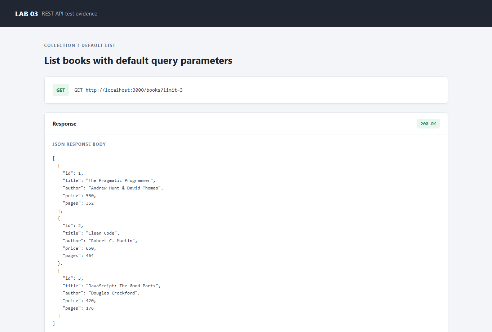
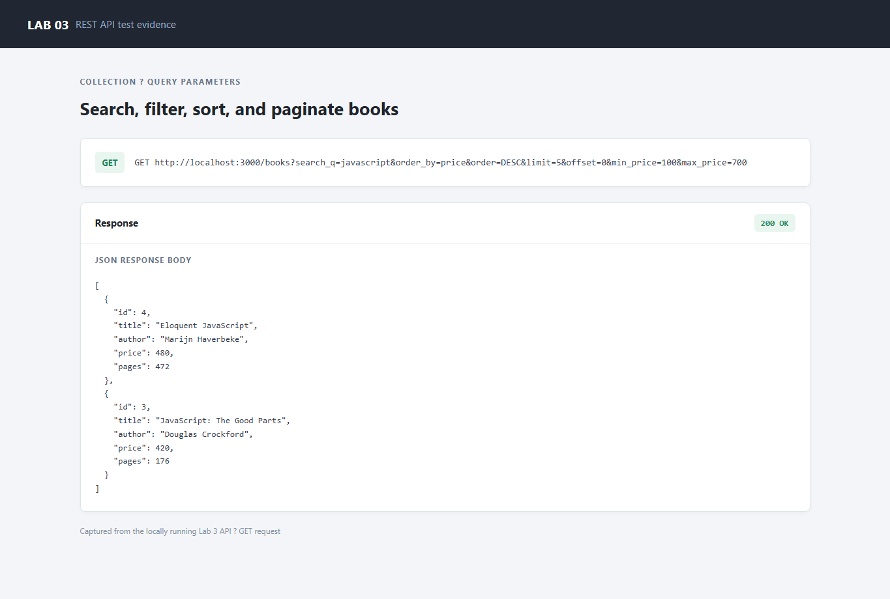
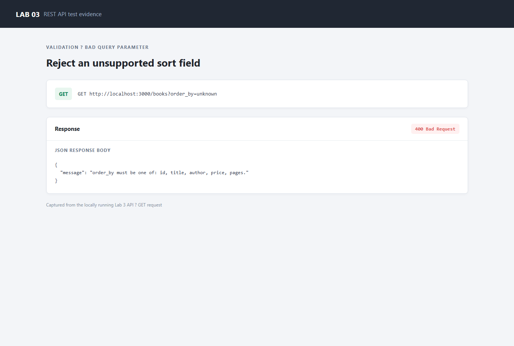
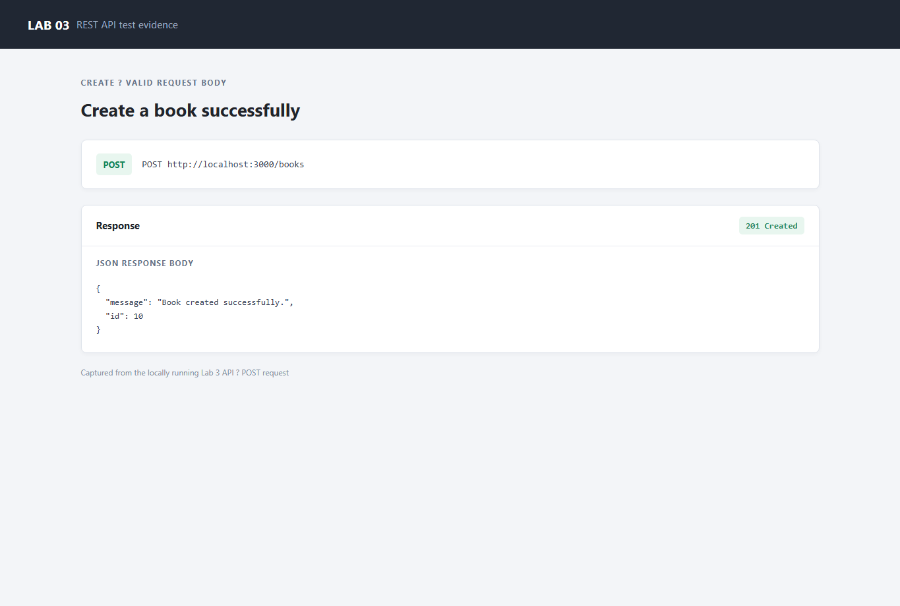
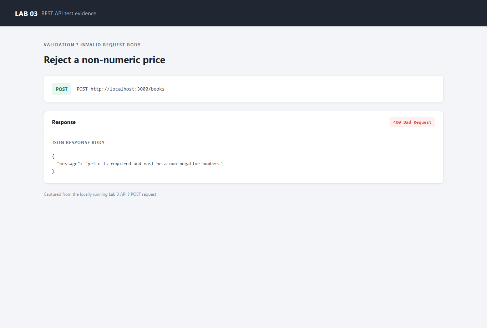
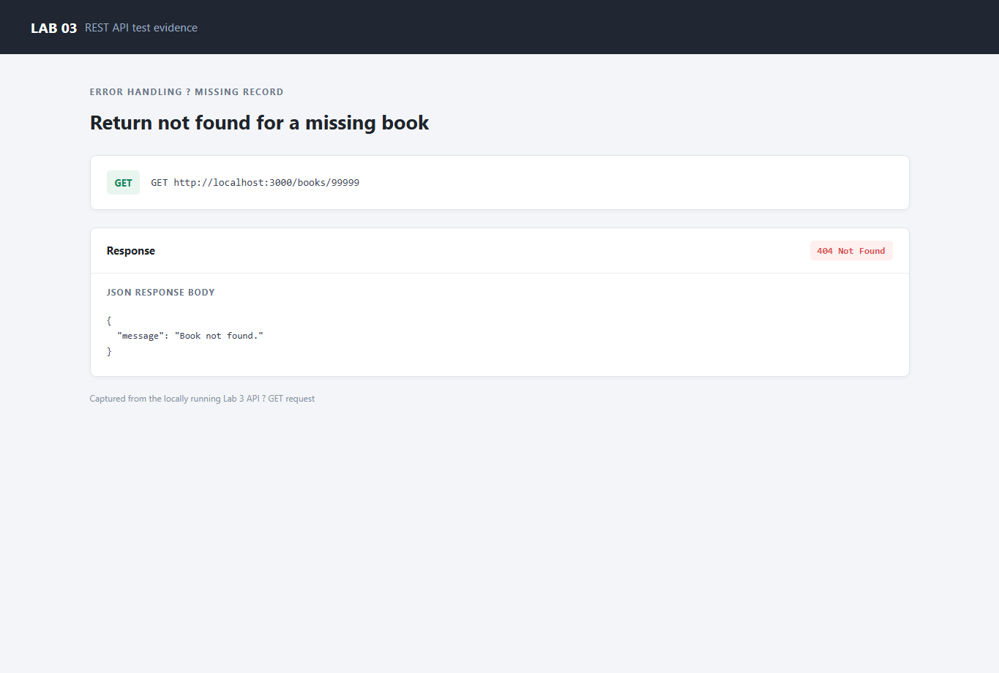
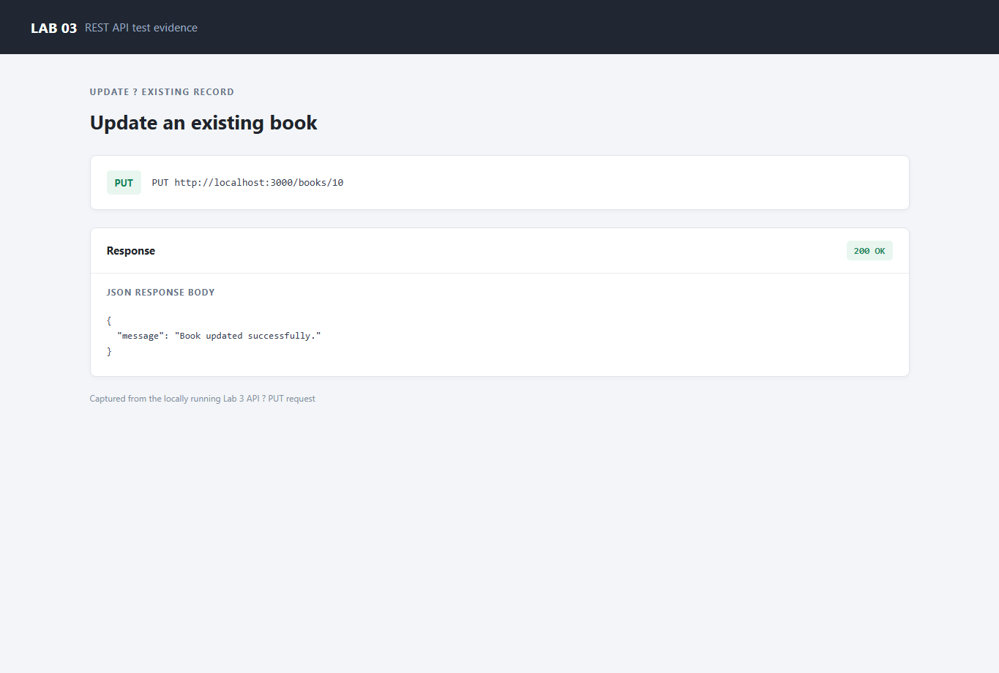
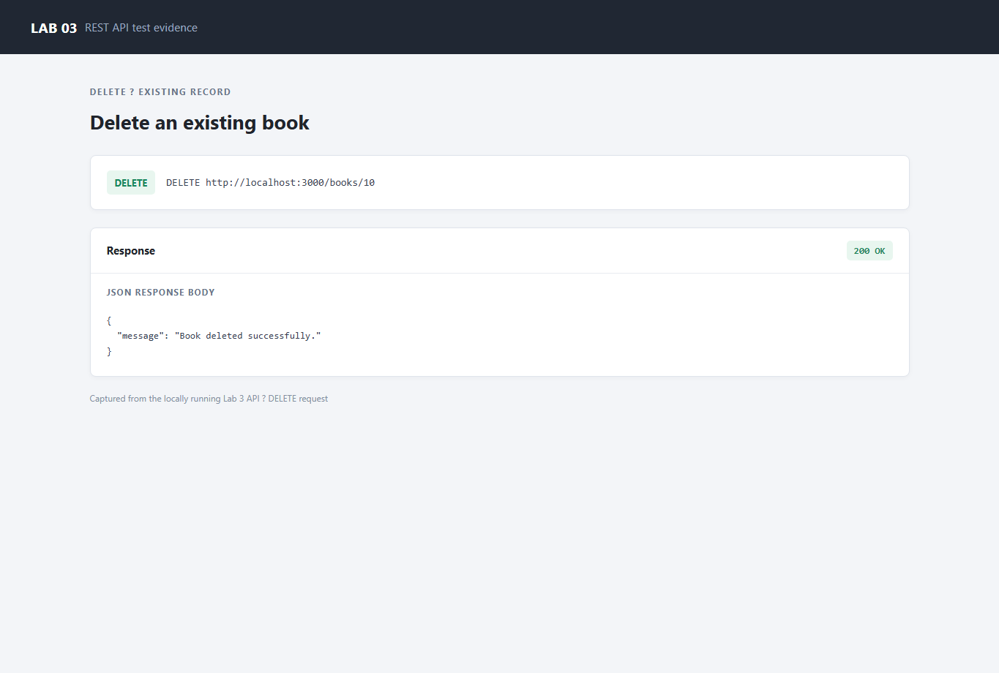

# Lab 3: REST API, Query Parameters, Validation, and Debugging

## Student Details

- Name: CH.Manvith Kumar
- Registration Number: 252U1R8014
- Section: S-14

## Objective

Extend the Lab 2 book API with REST-style noun endpoints, search, sorting, price filters, pagination, input validation, and consistent HTTP status codes.

## Requirements

- Node.js 18 or later
- npm

## Run the API

```powershell
cd lab-03
npm install
npm start
```

The API listens on `http://localhost:3000` (or the port in `PORT`). On first start it creates `database/books.db`, creates the `book` table, and inserts sample rows. The database and `node_modules` are not committed.

Run the automated API tests with:

```powershell
npm test
```

## Endpoints

| Method | Path | Purpose | Status codes |
|---|---|---|---|
| GET | `/books` | List books with optional search, sort, price filter, and pagination | 200, 400 |
| GET | `/books/:bookId` | Retrieve one book | 200, 400, 404 |
| POST | `/books` | Create a book | 201, 400 |
| PUT | `/books/:bookId` | Replace a book's editable fields | 200, 400, 404 |
| DELETE | `/books/:bookId` | Delete a book | 200, 400, 404 |

### List query parameters

| Parameter | Default | Description |
|---|---|---|
| `search_q` | empty | Partial, case-insensitive title search |
| `order_by` | `id` | Sort column: `id`, `title`, `author`, `price`, or `pages` |
| `order` | `ASC` | Sort direction: `ASC` or `DESC` |
| `limit` | `10` | Page size from 1 to 100 |
| `offset` | `0` | Number of matching rows to skip |
| `min_price` | none | Inclusive minimum price |
| `max_price` | none | Inclusive maximum price |

Example:

```text
GET /books?search_q=javascript&order_by=price&order=DESC&limit=5&offset=0&min_price=100&max_price=700
```

All errors use `{ "message": "..." }`. Request values are validated before use, and SQL values are passed as parameters. The sort column and direction are checked against allowed values before they are added to the query.

## Postman test list

Use the requests in [`requests.http`](./requests.http) with the REST Client extension, or create equivalent Postman requests against `http://localhost:3000`.

| Test | Request | Expected result |
|---|---|---|
| List defaults | `GET /books` | 200; up to 10 books |
| Search, sort, price range | `GET /books?search_q=javascript&order_by=price&order=DESC&min_price=100&max_price=700` | 200; matching titles sorted by descending price |
| Pagination | `GET /books?limit=2&offset=2` | 200; at most 2 books |
| Invalid sort column | `GET /books?order_by=title;DROP%20TABLE%20book` | 400 JSON message |
| Invalid price range | `GET /books?min_price=700&max_price=100` | 400 JSON message |
| Get existing book | `GET /books/1` | 200; book object |
| Get missing book | `GET /books/99999` | 404 JSON message |
| Create book | `POST /books` with title, author, and numeric price | 201; success message and new ID |
| Reject invalid book | `POST /books` with a missing title or `"price": "not-a-number"` | 400 JSON message |
| Update existing book | `PUT /books/1` with valid fields | 200 JSON message |
| Update missing book | `PUT /books/99999` with valid fields | 404 JSON message |
| Delete existing book | `DELETE /books/1` | 200 JSON message |
| Delete missing book | `DELETE /books/99999` | 404 JSON message |

## Screenshots

The following screenshots show responses captured from the locally running API:

### GET books with default parameters


### Search, price range, sorting, and pagination


### Invalid query parameter


### Create a book


### Reject invalid input


### Missing book


### Update a book


### Delete a book


## Debugging exercise notes

Use these checks to practise the four common failures without introducing broken code into the working API:

1. **`EADDRINUSE`**: another process is already listening on the selected port. Stop that process or start this server with a different `PORT`.
2. **Wrong import path**: verify relative module paths from the importing file and check the target file's exact name.
3. **`no such table`**: compare the table name in the query with the schema and confirm database initialization ran for the same database file.
4. **Missing `await`**: await database reads and writes before inspecting their results or sending the HTTP response.

## Viva preparation

- A path parameter identifies a resource in the URL (for example, `/books/1`); a query parameter filters or controls a collection (for example, `/books?limit=5`).
- A stateless API handles each request using the information in that request; it does not depend on prior request state stored on the server.
- Bad input returns `400 Bad Request`; a valid request for a missing record returns `404 Not Found`.
